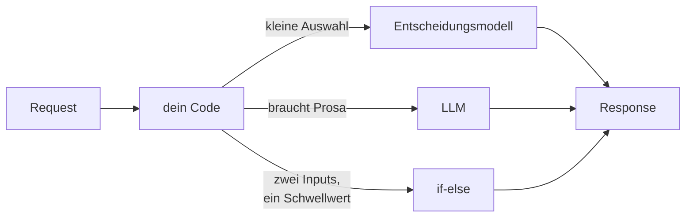

# Wer ist Jev?

## Spass mit Entscheidungsmodellen

<div class="draft-badge">DRAFT</div>

<div class="absolute bottom-10">
  <span class="font-700">
    David Übelacker
  </span>
</div>

---

# Wer bin ich?

- **David Übelacker**
- Software Architect @ nag informatik ag in Basel
- 20+ Jahre Erfahrung in der Web- und Mobile-App-Entwicklung

<div class="absolute bottom-10">
  <div class="flex items-end">
    
    <div style="width:45%"></div>
    <div style="width: 30%; display: flex; flex-direction: column; align-items: center;">
      
      <div>uebelacker.dev</div>
    </div>
  </div>
</div>

---
layout: full
---

<div class="newspaper">
  <div class="newspaper-masthead">Modell-Kurier</div>
  <hr class="newspaper-rule-thick"/>
  <div class="newspaper-articles">
    <div class="newspaper-article">
      <div class="newspaper-date">September 2026</div>
      <div class="newspaper-headline">Ein Modell, das keinen Satz schreiben kann, schlägt dein API-Gateway</div>
    </div>
    <div class="newspaper-divider"></div>
    <div class="newspaper-article">
      <div class="newspaper-date">Zwei Tage später</div>
      <div class="newspaper-headline">«Wir haben 400 Zeilen if-else durch vier ersetzt» &mdash; und die Benchmarks stimmen</div>
    </div>
    <div class="newspaper-divider"></div>
    <div class="newspaper-article">
      <div class="newspaper-date">Woche zwei</div>
      <div class="newspaper-headline">Jeder Anbieter hat jetzt einen Decision-Endpoint. Die meisten sind ein LLM im Trenchcoat.</div>
    </div>
    <div class="newspaper-divider"></div>
    <div class="newspaper-article">
      <div class="newspaper-date">Heute</div>
      <div class="newspaper-headline">Dein Tech Lead fragt, ob das in den Sprint kommt</div>
    </div>
  </div>
</div>

<!--
TODO — die vier Schlagzeilen durch die echten aus dem Jev-Launch ersetzen.
Form beibehalten: Launch -> glaubwürdiger Benchmark -> alle springen auf ->
es landet auf deinem Tisch. Screenshots echter Posts wirken hier noch besser.
-->

---
layout: full
---

<div class="big-quote">

Ein Modell, das keinen einzigen Satz schreiben kann.

Und stolz darauf ist.

</div>

---

# Der Fahrplan

<div class="agenda-list">

1. Was passiert ist, und warum der Hype eingeschlagen hat
2. Was ein Entscheidungsmodell *ist* &mdash; Zustand rein, typisierte Antwort raus
3. Live: eine Entscheidung aus ganz normalem Code holen
4. Die Alternativen, lokal und proprietär
5. Use Cases: die nützlichen, dann die lustigen
6. Wo es daneben liegt
7. Jev spielen lassen

</div>

---
layout: statement
---

# Kein Text. Keine Prosa. Keine Tokens zum Parsen.

## Du übergibst einen **Zustand** und **typisierte Fragen**.
## Es antwortet mit einer **Auswahl**, einem **Score** oder einer **Wahrscheinlichkeit**.

<div class="absolute bottom-20 text-xl opacity-70">
In einem Bruchteil einer Sekunde, zu einem Bruchteil der Kosten eines LLM-Calls.
</div>

---

# Anatomie eines Calls

<div class="grid grid-cols-2 gap-6">

<div>

**Du schickst**

```json
{
  "state": {
    "plan": "enterprise",
    "body": "dritter Ausfall diese Woche...",
    "customerSince": 12,
    "attachments": ["image/png"]
  },
  "questions": {
    "queue":    { "oneOf": ["billing",
                            "bug-triage",
                            "escalation",
                            "general"] },
    "priority": { "range": [1, 5] },
    "isSpam":   { "probability": true }
  }
}
```

</div>

<div>

**Du bekommst zurück**

```json
{
  "queue": "escalation",
  "priority": 5,
  "isSpam": 0.02
}
```

<div class="mt-8 text-lg">

- Drei Antworttypen: **Auswahl**, **Score**, **Wahrscheinlichkeit**
- Schon typisiert &mdash; nichts zu parsen, nichts zu wiederholen
- Das Schema *ist* der Prompt

</div>

</div>

</div>

<!--
TODO — vor dem Talk gegen die echte Jev-API prüfen. Die drei Antworttypen und
die Trennung state/questions stehen im Abstract; die konkreten Key-Namen und
das Schema-Vokabular ("oneOf", "range", "probability") sind mein Platzhalter.
Durch Copy-Paste aus der echten Doku ersetzen, damit das niemand im Publikum
auseinandernehmen kann.
-->

---

# Drei Wege zu entscheiden

<div class="compare">

<div class="compare-col">
<div class="compare-head">if-else</div>
<div class="compare-essence">du kennst die Regel</div>

- Sofort, kostenlos, komplett testbar
- Genau so klug wie am Tag, an dem du es geschrieben hast
- Jeder neue Fall ist ein neuer Branch
- Niemand traut sich, eine Zeile zu löschen

</div>

<div class="compare-col">
<div class="compare-head">Entscheidungsmodell</div>
<div class="compare-essence">du kennst die Frage</div>

- Unter einer Sekunde, Bruchteile eines Rappens
- Typisierte Antwort &mdash; kein Parsen, keine Retries
- Behandelt den Fall, den du vergessen hast
- Kann dir nicht sagen, *warum*

</div>

<div class="compare-col">
<div class="compare-head">LLM</div>
<div class="compare-essence">du willst einen Aufsatz</div>

- Sekunden, und die Rechnung summiert sich
- Erklärt sich selbst, überzeugend
- Freitext rein, Freitext zum Parsen raus
- Overkill für eine Ja/Nein-Entscheidung

</div>

</div>

<div class="compare-footer">

Der meiste Code bei uns ist die linke Spalte, die heimlich die mittlere spielt.

</div>

---

# Wo es sitzt



<div class="mt-6 text-xl opacity-80">
Es ersetzt nichts. Es füllt die Lücke zwischen einem Branch und einem Gespräch.
</div>

---

# Der Code, den wir alle haben

```ts
function routeTicket(ticket: Ticket): Queue {
  if (ticket.plan === 'enterprise' && ticket.sentiment < -0.5) return 'escalation'
  if (/refund|chargeback/i.test(ticket.body))                  return 'billing'
  if (ticket.attachments.some(a => a.type === 'image'))         return 'bug-triage'
  if (ticket.customerSince < 30 && ticket.plan !== 'free')      return 'onboarding'
  if (ticket.body.length < 40)                                  return 'needs-info'
  // ...neun weitere Branches.
  // drei davon "temporär" hinzugefügt, 2023.
  return 'general'
}
```

<div class="mt-6 text-xl">
Das hat niemand entschieden. Das ist <strong>gewachsen</strong>.
</div>

<!--
TODO — wenn möglich eine Kaskade aus einer echten Codebase einsetzen (mit
Freigabe). Echter Code bringt das Lachen des Wiedererkennens, erfundener nur
ein höfliches.
-->

---
layout: fact
---

# Live Coding

<div class="mt-8 text-2xl opacity-70">
eine Entscheidung, raus aus der Kaskade und rein in Jev
</div>

<!--
Netz für die Demo:
  1. routeTicket wie es ist, Tests grün
  2. Jev aufrufen mit state = ticket, eine Frage
  3. Kaskade löschen, Tests immer noch grün
  4. eine Frage ergänzen, die die Kaskade nie konnte (priority) - gratis
Wenn das Netz stirbt: der fertige Diff ist auf der nächsten Folie. Weiterreden.
-->

---

# Was der Diff entfernt hat

<div class="grid grid-cols-2 gap-8">

<div>

**Vorher**

- 14 Branches
- 6 Schwellwerte, die niemand begründen kann
- 1 Regex mit einem Kommentar, der sich dafür entschuldigt
- 0 Antworten für Zustände, die wir nie bedacht haben

</div>

<div>

**Nachher**

```ts
const { queue, priority } = await decide({
  state: ticket,
  questions: {
    queue: { oneOf: QUEUES },
    priority: { range: [1, 5] },
  },
})
```

<div class="mt-4">

Plus etwas, das wir vorher nie hatten: **Priority**, gratis.

</div>

</div>

</div>

---

# Jev ist nicht die einzige Option

<div class="grid grid-cols-2 gap-10 mt-4">

<div>

## Selbst betreiben

- Deine Hardware, dein Latenz-Minimum
- Keine Kosten pro Call, kein Rate Limit
- Daten verlassen das Haus nicht
- Du betreibst jetzt ein Modell
- Qualitätslücke &mdash; wie gross? *(messen!)*

</div>

<div>

## Proprietär

- Beste Zahlen, null Ops
- Fremde Uptime, fremde Roadmap
- Kosten pro Call, die mit dem Erfolg wachsen
- Deine Entscheidungen werden eine API-Abhängigkeit
- Modell-Updates, die du nicht bestellt hast

</div>

</div>

<div class="mt-8 text-xl opacity-80">
Entscheide zuerst nach <strong>Datensensibilität</strong>, dann nach Kosten. Latenz ist ein Tie-Breaker, kein Entscheider.
</div>

<!--
TODO — die echten Kandidaten in beiden Spalten benennen, mit echten Zahlen,
falls du sie benchmarkst. Eine namenlose "lokale Option" ist die schwächste
Folie im Deck.
-->

---

# Use Cases

<div class="grid grid-cols-2 gap-10 mt-2">

<div>

## Die, die du im Review verteidigen kannst

- **Routing** &mdash; Tickets, Leads, Alerts, Retries
- **Moderation** &mdash; Triage, bevor ein Mensch hinschaut
- **Sortieren** &mdash; Relevanz ohne Scoring-Funktion
- **Retry oder aufgeben** &mdash; ist dieser Fehler einen Versuch wert?
- **Welche Notification** &mdash; und ob überhaupt eine

</div>

<div>

## Die, die einfach Spass machen

- Welches von 40 Diagrammen diese Frage beantwortet
- Den nächsten Song wählen, aus der Stimmung im Raum
- Dinge benennen *(schlecht, aber sofort)*
- Entscheiden, ob ein PR-Titel lügt
- Spiele spielen

</div>

</div>

---
layout: fact
---

# 8–11s → <1s

<div class="mt-6 text-2xl opacity-70">
meine eigene App, dieselbe sortierte Liste, LLM gegen Entscheidungsmodell getauscht
</div>

<!--
TODO — die exakten Vorher/Nachher-Zahlen und die Stichprobengrösse besorgen,
bevor das auf einen Screen kommt. Das ist die glaubwürdigste Folie im Deck und
die, zu der am ehesten eine Rückfrage kommt. Kenne deinen p95, nicht nur den
Happy Path.
-->

---

# Wo es daneben liegt

- **Selbstsicher bei Zuständen, die es nie gesehen hat.** Es antwortet immer. Das ist nicht dasselbe wie wissen.
- **Typisiert heisst nicht korrekt.** Die Form stimmt. Die Auswahl kann trotzdem Unsinn sein.
- **Keine Begründungen.** Preise, Anspruch, Moderations-Einsprüche &mdash; wenn du jemandem eine Erklärung schuldest, brauchst du Code.
- **Stille Drift.** Das Modell wird aktualisiert, dein Verhalten ändert sich, und in deinem Repo hat sich nichts geändert.
- **Deine Tests werden probabilistisch.** «Gibt meistens escalation zurück» ist kein grüner Build.

<div class="mt-8 text-xl opacity-80">
Kein Hype übersteht den Kontakt mit Produktion. Suche den Fehlerfall, bevor er dich findet.
</div>

---

# Montagmorgen

<div class="grid grid-cols-2 gap-10 mt-2">

<div>

## Guter Kandidat

- Kleine, geschlossene Menge an Ergebnissen
- Viele Inputs, keiner davon entscheidend
- Eine falsche Antwort ist günstig und reparierbar
- Du hast schon eine Diskussion über den Schwellwert verloren
- Die Regel ändert sich schneller, als du deployen kannst

</div>

<div>

## Finger weg

- Jemand kann eine Begründung verlangen → **Code**
- Zwei Inputs, ein Schwellwert → **Code**
- Muss für immer identisch bleiben → **Code**
- Das Ergebnis ist Prosa für einen Menschen → **LLM**
- Du kannst die Frage nicht formulieren → **keines von beiden**

</div>

</div>

<div class="mt-8 text-xl">
Öffne deine Codebase und suche nach <code>else if</code>. Fang beim längsten Treffer an.
</div>

---
layout: fact
---

# Was ist ein Spiel,

## wenn nicht ein Zustand und die Frage nach dem nächsten Zug?

<!--
Live-Demo. Bei einem Spiel bleiben, Brett auf dem Screen lassen, den Zustand
rein und die Auswahl raus laut mitsprechen.
TODO - Spiel auswählen und vorher verkabeln. Etwas mit sichtbarem Brett und
kleiner Menge erlaubter Züge: Tic-Tac-Toe ist zu gelöst, um zu beeindrucken,
Schach zu langsam zum Kommentieren. Vier gewinnt liest sich auch aus der
letzten Reihe gut.
-->

---

# Takeaways

<div class="agenda-list">

1. Ein Entscheidungsmodell ist **Zustand rein, typisierte Antwort raus** &mdash; kein LLM, kein Klassifikator, keine Rules Engine
2. Du rufst es in vier Zeilen auf, und das **Schema ist der Prompt**
3. Lokal oder proprietär: entscheide nach **Datensensibilität**, dann nach Kosten
4. Gute Kandidaten sind **klein, geschlossen und günstig, wenn sie falsch sind**
5. Wenn jemand eine Begründung verdient, **behalte dein if-else**

</div>

---
layout: fact
---

# Vielen Dank!

<br/>

<div class="center">

</div>

https://github.com/uebelack/who-is-jev
