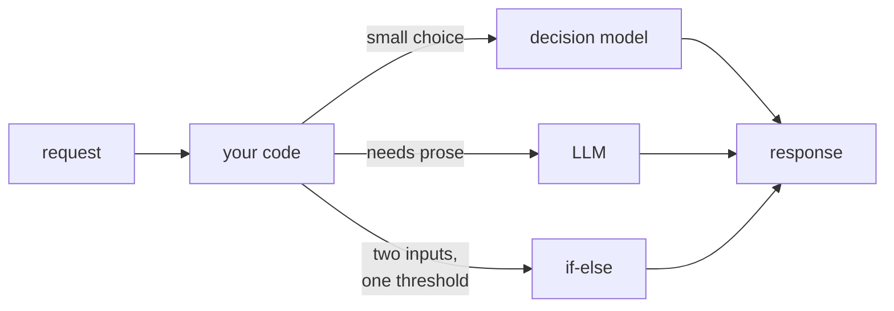

# Who Is Jev?

## Fun with Decision Models

<div class="draft-badge">DRAFT</div>

<div class="absolute bottom-10">
  <span class="font-700">
    David Übelacker
  </span>
</div>

---

# Who am I?

- **David Übelacker**
- Software Architect @ nag informatik ag in Basel
- 20+ years of experience in web and mobile app development

<div class="absolute bottom-10">
  <div class="flex items-end">
    
    <div style="width:45%"></div>
    <div style="width: 30%; display: flex; flex-direction: column; align-items: center;">
      
      <div>uebelacker.dev</div>
    </div>
  </div>
</div>

---
layout: full
---

<div class="newspaper">
  <div class="newspaper-masthead">The Model Times</div>
  <hr class="newspaper-rule-thick"/>
  <div class="newspaper-articles">
    <div class="newspaper-article">
      <div class="newspaper-date">September 2026</div>
      <div class="newspaper-headline">A model that cannot write a sentence just beat your API gateway</div>
    </div>
    <div class="newspaper-divider"></div>
    <div class="newspaper-article">
      <div class="newspaper-date">Two days later</div>
      <div class="newspaper-headline">"We replaced 400 lines of if-else with four" &mdash; and the benchmarks are real</div>
    </div>
    <div class="newspaper-divider"></div>
    <div class="newspaper-article">
      <div class="newspaper-date">Week two</div>
      <div class="newspaper-headline">Every vendor now ships a decision endpoint. Most of them are an LLM in a trench coat.</div>
    </div>
    <div class="newspaper-divider"></div>
    <div class="newspaper-article">
      <div class="newspaper-date">Today</div>
      <div class="newspaper-headline">Your tech lead wants to know if this goes in the sprint</div>
    </div>
  </div>
</div>

<!--
TODO — replace these four with the real headlines from the actual Jev launch
cycle. Keep the shape: launch -> credible benchmark -> everyone piles on ->
it lands on your desk. Screenshots of real posts work even better here.
-->

---
layout: full
---

<div class="big-quote">

A model that can't write a single sentence.

And is proud of it.

</div>

---

# Where we're going

<div class="agenda-list">

1. What actually happened, and why the hype landed
2. What a decision model *is* &mdash; state in, typed answer out
3. Live: pulling one decision out of ordinary code
4. The alternatives, local and proprietary
5. Use cases: the useful ones, then the fun ones
6. Where it gets it wrong
7. Letting Jev play

</div>

---
layout: statement
---

# No text. No prose. No tokens to parse.

## You hand it a **state** and **typed questions**.
## It hands back a **choice**, a **score**, or a **probability**.

<div class="absolute bottom-20 text-xl opacity-70">
In a fraction of a second, at a fraction of the cost of an LLM call.
</div>

---

# Anatomy of a call

<div class="grid grid-cols-2 gap-6">

<div>

**You send**

```json
{
  "state": {
    "plan": "enterprise",
    "body": "third outage this week...",
    "customerSince": 12,
    "attachments": ["image/png"]
  },
  "questions": {
    "queue":    { "oneOf": ["billing",
                            "bug-triage",
                            "escalation",
                            "general"] },
    "priority": { "range": [1, 5] },
    "isSpam":   { "probability": true }
  }
}
```

</div>

<div>

**You get back**

```json
{
  "queue": "escalation",
  "priority": 5,
  "isSpam": 0.02
}
```

<div class="mt-8 text-lg">

- Three answer kinds: **choice**, **score**, **probability**
- Already typed &mdash; nothing to parse, nothing to retry
- The schema *is* the prompt

</div>

</div>

</div>

<!--
TODO — confirm against the real Jev API before presenting. The three answer
kinds and the state/questions split come from the abstract; the exact key
names and the schema vocabulary ("oneOf", "range", "probability") are my
placeholder. Replace with a copy-paste from the real docs so nobody in the
room can catch this out.
-->

---

# Three ways to decide

<div class="compare">

<div class="compare-col">
<div class="compare-head">if-else</div>
<div class="compare-essence">you know the rule</div>

- Instant, free, fully testable
- Exactly as clever as the day you wrote it
- Every new case is a new branch
- Nobody dares delete a line of it

</div>

<div class="compare-col">
<div class="compare-head">decision model</div>
<div class="compare-essence">you know the question</div>

- Sub-second, fractions of a cent
- Typed answer &mdash; no parsing, no retries
- Handles the case you forgot
- Cannot tell you *why*

</div>

<div class="compare-col">
<div class="compare-head">LLM</div>
<div class="compare-essence">you want an essay</div>

- Seconds, and the bill adds up
- Explains itself, convincingly
- Free text in, free text to parse out
- Overkill for a two-way choice

</div>

</div>

<div class="compare-footer">

Most of our software is the left column, quietly pretending to be the middle one.

</div>

---

# Where it sits



<div class="mt-6 text-xl opacity-80">
It does not replace anything. It fills the gap between a branch and a conversation.
</div>

---

# The code we all have

```ts
function routeTicket(ticket: Ticket): Queue {
  if (ticket.plan === 'enterprise' && ticket.sentiment < -0.5) return 'escalation'
  if (/refund|chargeback/i.test(ticket.body))                  return 'billing'
  if (ticket.attachments.some(a => a.type === 'image'))         return 'bug-triage'
  if (ticket.customerSince < 30 && ticket.plan !== 'free')      return 'onboarding'
  if (ticket.body.length < 40)                                  return 'needs-info'
  // ...nine more branches.
  // three of them added "temporarily", in 2023.
  return 'general'
}
```

<div class="mt-6 text-xl">
Nobody decided this. It <strong>accreted</strong>.
</div>

<!--
TODO — swap in a cascade from a real codebase if you can get clearance for it.
Real code gets a laugh of recognition; invented code gets a polite one.
-->

---
layout: fact
---

# Live coding

<div class="mt-8 text-2xl opacity-70">
one decision, out of the cascade and into Jev
</div>

<!--
Safety net for the demo:
  1. routeTicket as-is, tests green
  2. call Jev with state = ticket, one question
  3. delete the cascade, tests still green
  4. add a question the cascade never handled (priority) - free
If the network dies: the finished diff is on the next slide. Keep talking.
-->

---

# What the diff removed

<div class="grid grid-cols-2 gap-8">

<div>

**Before**

- 14 branches
- 6 thresholds nobody can justify
- 1 regex with a comment apologising for it
- 0 answers for states we never imagined

</div>

<div>

**After**

```ts
const { queue, priority } = await decide({
  state: ticket,
  questions: {
    queue: { oneOf: QUEUES },
    priority: { range: [1, 5] },
  },
})
```

<div class="mt-4">

Plus one thing we never had: **priority**, for free.

</div>

</div>

</div>

---

# Jev isn't the only option

<div class="grid grid-cols-2 gap-10 mt-4">

<div>

## Run it yourself

- Your hardware, your latency floor
- No per-call bill, no rate limit
- Data never leaves the building
- You now operate a model
- Quality gap &mdash; how big? *(measure it)*

</div>

<div>

## Proprietary

- Best numbers, zero ops
- Someone else's uptime, someone else's roadmap
- Per-call cost that scales with success
- Your decisions become an API dependency
- Model updates you did not ask for

</div>

</div>

<div class="mt-8 text-xl opacity-80">
Pick on <strong>data sensitivity</strong> first, cost second. Latency is a tie-breaker, not a decider.
</div>

<!--
TODO — name the actual contenders in each column, with real numbers if you
benchmark them. An unnamed "local option" is the weakest slide in the deck.
-->

---

# Use cases

<div class="grid grid-cols-2 gap-10 mt-2">

<div>

## The ones you can defend in a review

- **Routing** &mdash; tickets, leads, alerts, retries
- **Moderation** &mdash; triage before a human looks
- **Sorting** &mdash; relevance with no scoring function
- **Retry or give up** &mdash; is this error worth another go?
- **Which notification** &mdash; and whether to send one at all

</div>

<div>

## The ones you do for fun

- Which of 40 charts answers this question
- Picking the next track, from the room's mood
- Naming things *(badly, but instantly)*
- Deciding whether a PR title is a lie
- Playing games

</div>

</div>

---
layout: fact
---

# 8–11s → <1s

<div class="mt-6 text-2xl opacity-70">
my own app, same sorted list, LLM swapped for a decision model
</div>

<!--
TODO — get the exact before/after numbers and the sample size before you put
this on a screen. This is the single most credible slide in the deck and the
one most likely to get a follow-up question. Know your p95, not just the
happy path.
-->

---

# Where it gets it wrong

- **Confidence on states it has never seen.** It always answers. That is not the same as knowing.
- **Typed is not correct.** The shape validates. The choice can still be nonsense.
- **No reasons.** Pricing, eligibility, moderation appeals &mdash; if you owe someone an explanation, you need code.
- **Silent drift.** The model updates, your behaviour changes, and nothing in your repo did.
- **Your tests go probabilistic.** "Usually returns escalation" is not a green build.

<div class="mt-8 text-xl opacity-80">
No hype survives contact with production. Go looking for the failure before it finds you.
</div>

---

# Monday morning

<div class="grid grid-cols-2 gap-10 mt-2">

<div>

## Good candidate

- Small, closed set of outcomes
- Many inputs, none of them decisive
- A wrong answer is cheap and recoverable
- You have already lost an argument about the threshold
- The rule changes faster than you can ship

</div>

<div>

## Leave it alone

- Someone can demand a reason → **code**
- Two inputs, one threshold → **code**
- Must be byte-identical forever → **code**
- The output is prose for a human → **LLM**
- You cannot define the question → **neither**

</div>

</div>

<div class="mt-8 text-xl">
Open your codebase and search for <code>else if</code>. Start at the longest hit.
</div>

---
layout: fact
---

# What is a game,

## if not a state and a question about the next move?

<!--
Live demo. Keep it to one game, keep the board on screen, narrate the state
going in and the choice coming out.
TODO - pick the game and pre-wire it. Something with a visible board and a
small legal-move set: tic-tac-toe is too solved to impress, chess is too slow
to narrate. Connect Four reads well from the back of the room.
-->

---

# Takeaways

<div class="agenda-list">

1. A decision model is **state in, typed answer out** &mdash; not an LLM, not a classifier, not a rules engine
2. You call it in four lines, and the **schema is the prompt**
3. Local or proprietary: decide on **data sensitivity**, then cost
4. Good candidates are **small, closed, and cheap to get wrong**
5. When someone is owed a reason, **keep your if-else**

</div>

---
layout: fact
---

# Thank you!

<br/>

<div class="center">

</div>

https://github.com/uebelack/who-is-jev
